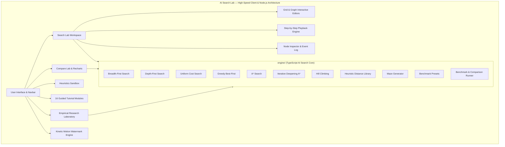
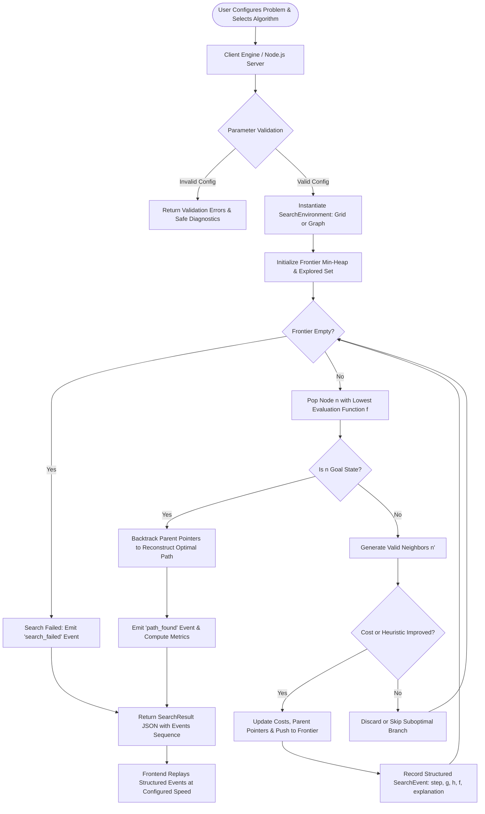

# AI Search Lab — Interactive Search Algorithm Visualiser & Teaching Tool
### Topic: Artificial Intelligence Foundations — Search Algorithms

---

## 1. Abstract & Project Statement

**AI Search Lab** is a full-stack educational web platform engineered to demonstrate, visualize, and benchmark classical state-space search algorithms. Built specifically for the **Artificial Intelligence Foundations** curriculum, it bridges the gap between theoretical algorithmic proofs and dynamic visual intuition.

Students and educators can construct custom grid mazes with non-uniform weighted terrain (e.g., mud swamps) and arbitrary graph networks (including the classic Russell & Norvig Romania road map), execute seven distinct classical AI search algorithms with deterministic step-by-step playback, inspect mathematical evaluation functions ($g(n)$, $h(n)$, and $f(n)$), compare performance side-by-side using interactive charts, conduct reproducible benchmark experiments, and prepare for university viva examinations.

---

## 2. Key Architectural Features

- **7 Fully Implemented Search Algorithms**:
  1. **Breadth-First Search (BFS)**: Level-by-level queue traversal; optimal for unit costs.
  2. **Depth-First Search (DFS)**: Deep branch exploration with cycle prevention; linear memory.
  3. **Uniform Cost Search (UCS / Dijkstra)**: Priority queue ordered by $g(n)$; optimal for non-negative weighted graphs.
  4. **Greedy Best-First Search**: Priority queue guided purely by $h(n)$; rapid, non-optimal.
  5. **A\* Search**: Evaluates $f(n) = g(n) + h(n)$; optimal with admissible heuristics, supports node reopening.
  6. **Iterative Deepening A\* (IDA\*)**: Memory-efficient depth-first search bounded by iterative f-cost cutoffs.
  7. **Hill Climbing**: Local steepest-descent search; supports configurable sideways moves, plateau detection, and random restarts.
- **Dual Problem Paradigms**:
  - **Grid Maze Editor**: Configurable dimensions (5x5 to 50x50), interactive wall drawing/erasing, mud swamp terrain ($4.5\times$ cost multiplier), 4-directional and 8-directional diagonal movement (with step cost $\sqrt{2} \approx 1.414$).
  - **Graph Editor**: Interactive SVG canvas for node placement, weighted edges, draggable layout, and built-in benchmarks (Romania map with straight-line distances to Bucharest, Diamond network).
- **Faithful Step-by-Step Playback Engine**:
  - Play, pause, resume, single-step forward, single-step backward, speed adjustment (10ms to 400ms), and timeline scrubbing.
  - Visual distinction with accessible color tokens and text labels: Start (Green), Goal (Red), Walls (Dark Slate), Mud (Amber), Frontier (Cyan), Explored (Indigo), Current Node (Gold), and Solution Path (Emerald).
  - Live state inspector showing node coordinates, $g(n)$, $h(n)$, $f(n)$, status, parent pointer, and human-readable educational explanations for every transition.
- **Empirical Multi-Algorithm Comparison**:
  - Simultaneous benchmarking of 2 to 7 algorithms on the exact same problem configuration.
  - Metrics: Solution Found, Path Cost, Path Length, Nodes Expanded, Nodes Generated, Max Frontier Size, Execution Time (ms).
  - Recharts bar charts and auto-generated analytical narrative explaining search trade-offs.
  - One-click export to CSV and portable JSON.
- **Heuristics Laboratory**:
  - Interactive distance probe for Manhattan, Euclidean, Octile, Chebyshev, and Zero heuristics.
  - Mathematical explanations of admissibility ($h(n) \le h^*(n)$) and consistency ($h(n) \le c(n, a, n') + h(n')$).
  - Demonstrates why Manhattan distance violates admissibility under 8-directional movement.
- **Guided Tutorial & Viva Preparation**:
  - 16 university-level curriculum lessons covering formal problem formulation, blind strategies, heuristic admissibility proofs, local landscape pathologies, mathematical invariant derivations, and viva defense strategies.
  - Interactive knowledge-check quizzes with immediate feedback and model viva defense answers.
- **Empirical Research & Benchmarking Laboratory**:
  - 8 standardized academic benchmark suites (Obstacle density, Weighted mud swamps, Heuristic dominance, RAM memory scaling, Concave U-traps, Romania road map, Disconnected completeness, 8-way diagonal connectivity).
  - Point-by-point empirical dissections, academic metric glossary ($b^*$, Search Penetrance, Frontier RAM Ratio, Suboptimality $\Delta\%$), and one-click export to CSV, JSON, and LaTeX paper tables.
- **Kinetic Motion Watermark & Responsive Light Aesthetic**:
  - Continuous animated typography streams, fluid ambient SVG wave caustics, and an interactive watermark intensity switcher (Bold, Vivid, Subtle, Off).

---

## 3. System Architecture



### Search Execution Lifecycle Flowchart



---

## 4. Algorithm Comparison Matrix

| Algorithm | Category | Data Structure | Time Complexity | Space Complexity | Completeness | Optimality |
| :--- | :--- | :--- | :--- | :--- | :--- | :--- |
| **BFS** | Uninformed | FIFO Queue | $O(b^d)$ | $O(b^d)$ | Complete | Optimal for unit costs |
| **DFS** | Uninformed | LIFO Stack | $O(b^m)$ | $O(bm)$ | Complete (with cycle check) | Non-optimal |
| **UCS** | Uninformed | Min-Priority Queue | $O(b^{1 + \lfloor C^* / \epsilon \rfloor})$ | $O(b^{1 + \lfloor C^* / \epsilon \rfloor})$ | Complete ($\epsilon > 0$) | Optimal for non-negative costs |
| **Greedy** | Informed | Min-Priority Queue ($h$) | $O(b^m)$ worst | $O(b^m)$ | Complete (finite space) | Non-optimal |
| **A\*** | Informed | Min-Priority Queue ($g+h$) | $O(b^d)$ worst | $O(b^d)$ | Complete ($\epsilon > 0$) | Optimal ($h$ admissible/consistent) |
| **IDA\*** | Informed | Recursive DFS with bound | $O(b^d)$ worst | $O(d)$ linear | Complete ($\epsilon > 0$) | Optimal ($h$ admissible) |
| **Hill Climbing** | Local Search | Current State Pointer | $O(\infty)$ if looping | $O(1)$ constant | Incomplete | Non-optimal |

---

## 5. Technology Stack

- **Frontend**:
  - React 18 with TypeScript 5.4+
  - Vite 5 build tool & lightning-fast development server
  - Tailwind CSS 3 for responsive, modern light aesthetic
  - Lucide React icon set
  - Recharts for comparative performance data visualizations
- **Backend & Core Engine**:
  - Pure Node.js & TypeScript architecture (zero Python dependencies)
  - Native Node.js HTTP server (`server.js`) with static asset and API health endpoints
  - Deterministic in-memory priority queue heaps and search environments
  - Automated exports: CSV, portable JSON, and publication-ready LaTeX tables


---

## 6. Installation & Execution Guide

### Prerequisites
- Node.js 18+ and npm (Node.js v20.18.0 installed)

### 1. One-Click Launch
Double-click `START_APP.bat` in the project root to start the server and automatically launch the browser at `http://localhost:5173/`.

### 2. Manual Terminal Commands
```powershell
# Navigate to frontend directory
cd frontend

# Install dependencies
npm install

# Start Vite dev server on port 5173
npm run dev
```
Open your browser and visit: `http://localhost:5173/`.

### 2. Frontend Setup & Startup
```powershell
# Open a new terminal and navigate to frontend directory
cd frontend

# Install dependencies
npm install

# Build production bundle (verifies TypeScript & bundle integrity)
npm run build

# Start Vite dev server on port 5173
npm run dev -- --host 127.0.0.1 --port 5173
```
Open your browser and visit: `http://127.0.0.1:5173/`.

---

## 7. API Reference

| Method | Endpoint | Description |
| :--- | :--- | :--- |
| `GET` | `/api/health` | Returns service health, version, and list of supported algorithms. |
| `GET` | `/api/algorithms` | Returns pseudocode, complexity, and viva questions for all 7 algorithms. |
| `GET` | `/api/presets` | Returns preconfigured grid and graph environments. |
| `POST` | `/api/validate` | Validates start/goal coordinates, walls, bounds, and edge weights. |
| `POST` | `/api/search` | Executes a single algorithm; returns path, metrics, and structured event history. |
| `POST` | `/api/compare` | Runs multiple algorithms on identical problem state; returns comparison items and narrative. |
| `POST` | `/api/maze/generate` | Algorithmic maze generator (Recursive division, Prim's, Rooms, Random) with seeds. |
| `POST` | `/api/experiments/run`| Runs reproducible benchmark suites for algorithm evaluation. |

---

## 8. University Viva Preparation Q&A

**Q1: Under what specific conditions is A\* guaranteed to be optimal?**  
*Answer:* For tree search, the heuristic $h(n)$ must be **admissible** ($0 \le h(n) \le h^*(n)$), meaning it never overestimates the true remaining distance to the goal. For graph search with a closed set, $h(n)$ must be **consistent** (monotonic), satisfying the triangle inequality $h(n) \le c(n, a, n') + h(n')$. Consistency guarantees that the first time a node is expanded from the priority queue, its path is strictly optimal.

**Q2: Why is Manhattan distance admissible for 4-directional grids but inadmissible for 8-directional movement?**  
*Answer:* In 8-directional movement, diagonal transitions cost $\sqrt{2} \approx 1.414$, while Manhattan distance computes $|dx| + |dy| = 2.0$ for the same displacement. Because $2.0 > 1.414$, Manhattan overestimates diagonal distance, violating admissibility. The Octile metric must be used instead.

**Q3: Why must the goal test in Uniform Cost Search be performed upon popping a node from the priority queue, rather than upon generation?**  
*Answer:* Testing upon generation can terminate prematurely with a suboptimal path. A node might be generated with an expensive step cost, but a cheaper route through a different branch might be discovered later. Waiting until the node is popped with the minimum $g(n)$ guarantees that all cheaper candidate paths have been exhausted.

**Q4: What fundamental trade-off does Iterative Deepening A\* (IDA\*) represent?**  
*Answer:* Standard A\* suffers from exponential memory consumption ($O(b^d)$) because it maintains all frontier and explored nodes in memory. IDA\* solves this by using depth-first search bounded by an f-cost threshold, achieving linear memory ($O(d)$). The trade-off is computational overhead: earlier levels are repeatedly explored across iterations.

**Q5: Why does Hill Climbing fail even when an unblocked path to the goal exists?**  
*Answer:* Hill Climbing is a local search algorithm with zero memory and no backtracking frontier. If navigating around an obstacle requires temporarily moving away from the goal (increasing $h(n)$), Hill Climbing observes that all adjacent neighbors have higher heuristic scores, falsely concludes it is at a local maximum/minimum, and terminates.

---

## 9. Feature Compliance Verification

| Requirement | Status | Implementation Details |
| :--- | :---: | :--- |
| **All 7 Classical AI Search Algorithms** | Completed | BFS, DFS, UCS, Greedy, A\*, IDA\*, and Hill Climbing implemented with correct data structures. |
| **Interactive Grid & Graph Editors** | Completed | Grid with wall drawing, mud painting, and start/goal repositioning; SVG Graph editor with weighted edges. |
| **Real Step-by-Step Playback** | Completed | Play, pause, scrub, step forward/backward driven by actual backend `SearchEvent` sequences. |
| **Side-by-Side Comparison Engine** | Completed | Multi-algorithm comparison with shared inputs, Recharts metrics charts, and analytical narrative. |
| **Non-Uniform Weighted Terrain** | Completed | Mud terrain ($4.5\times$ cost multiplier) proves UCS/A\* optimality over BFS. |
| **Heuristics Evaluation & Sandbox** | Completed | Manhattan, Euclidean, Octile, Chebyshev, and Zero distance formulas with admissibility analysis. |
| **Academic Benchmark Experiments** | Completed | Reproducible seeded benchmarks with exportable CSV/JSON reports and print styling. |
| **Pure Node.js & TypeScript Engine** | Completed | Fast in-memory execution, standalone client-side and server-side deployment with zero Python setup. |
| **Production Build & Documentation** | Completed | Clean TypeScript Vite build, Netlify-ready configuration, system diagrams, and Viva prep. |

---

## 10. License & Credits

Developed for **Artificial Intelligence Foundations**.  
Built with classical AI principles adapted from *Artificial Intelligence: A Modern Approach (4th Edition)* by Stuart Russell & Peter Norvig.
